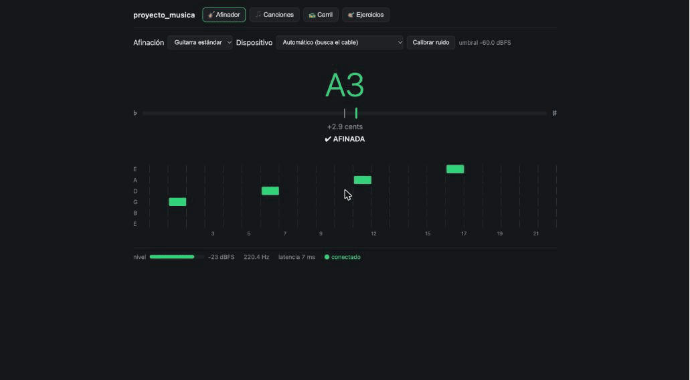

# guitar-practice-trainer

[](https://github.com/Giocrisrai/guitar-practice-trainer/actions/workflows/pruebas.yml)


> **English:** Free software to practice guitar on macOS with the Rocksmith Real Tone USB cable. Real-time pitch detection drives a tuner and fretboard monitor, monophonic exercises (scales, arpeggios, intervals, sight-reading) graded on note, intonation and tempo, and a play-along lane for full pieces. Python audio core + React 19 interface. Not affiliated with Ubisoft. Documentation below is in Spanish.



> El video se grabó con el gemelo digital (`uv run python -m herramientas.gemelo`): un guitarrista sintético toca por donde entra el cable, sin guitarra ni micrófono.

Software libre para practicar guitarra en macOS con el cable Rocksmith Real Tone.
Etapa 1: afinador y monitor de notas en el mástil. Etapa 2a: ejercicios
monofónicos (escalas, arpegios, intervalos y lectura) con corrección de nota,
afinación y tempo. Etapa 3a: el carril, para tocar una pieza con la música
corriendo. Etapa 3b: importar canciones de Guitar Pro, MusicXML, MIDI y
tablatura de texto. Etapa 3c: practicar la pieza con compases, bucles y tempo
ajustable. Etapa 3d: un **gemelo digital** —un guitarrista sintético que genera
audio de verdad y lo mete por donde entra el cable— para poder ver la sesión
correr sin tener la guitarra enchufada. Etapa 3e: **la pieza suena de fondo
mientras la tocas**, sintetizada de la partitura —y antes de encenderla hay que
leer lo del micrófono, que está al principio de esa sección.

## Requisitos

- macOS con permiso de micrófono concedido al terminal
  (Ajustes del Sistema → Privacidad y seguridad → Micrófono)
- Python 3.13 (pyenv) — el archivo `.python-version` fija `3.13.1`, y `uv`
  lo respeta automáticamente al crear el entorno
- [uv](https://docs.astral.sh/uv/) como gestor del entorno Python
- pnpm
- Cable Rocksmith USB Guitar Adapter

## Instalación

```bash
uv sync
cd interfaz && pnpm install && pnpm build && cd ..
```

`uv sync` crea `.venv/` con Python 3.13.1 (según `.python-version`), instala las
dependencias de ejecución y el proyecto en modo editable, según lo fijado en
`uv.lock`.

## Uso

```bash
uv run guitarra
```

Abre `http://127.0.0.1:8420` en el navegador.

Opciones del comando:

- `--puerto`: cambia el puerto en el que escucha el servidor (por defecto 8420).
  Ejemplo: `uv run guitarra --puerto 8080`.
- `--sin-navegador`: levanta el servidor sin abrir el navegador automáticamente.

### El dispositivo se detecta solo

El selector **Dispositivo** viene en **Automático**: el cable Rocksmith se busca
por su nombre en cada intento de apertura, que ocurre cada pocos segundos. Eso
significa que puedes enchufar el cable con el servidor ya abierto y el afinador
lo recogerá sin que toques nada, y que desenchufarlo y volver a enchufarlo
funciona igual aunque macOS le cambie el número de entrada, cosa que hace a
menudo.

Si eliges un dispositivo concreto, se guarda **por su nombre** y se respeta
mientras siga conectado. Guardarlo por índice, como se hacía antes, dejaba el
afinador diciendo «reconéctalo» con el cable enchufado delante en cuanto macOS
renumeraba las entradas. Si el que elegiste desaparece y el cable está presente,
se usa el cable y el aviso de arriba lo dice: sustituirlo en silencio sería peor.

Si el cable está conectado y aun así no captura, mira el mensaje de la barra
superior. `otro_dispositivo` significa que se está capturando otra entrada;
elige el cable en el selector. Un error del sistema al abrirlo
(`PaErrorCode -9986` y parecidos) casi siempre es el permiso de micrófono sin
conceder —**Ajustes del Sistema → Privacidad y seguridad → Micrófono**, para la
aplicación desde la que lanzaste el servidor, y reinicia después— o bien otra
aplicación que tiene el cable tomado.

Si desconectas el cable mientras tocas, el afinador pasa a silencio y vuelve a
abrirlo solo en cuanto lo enchufas de nuevo: no hace falta reiniciar nada.

El botón **Calibrar ruido** mide el piso de ruido de tu equipo durante dos
segundos —no toques nada mientras dura— y guarda el umbral resultante en la
configuración. El valor vigente se muestra siempre junto al botón.

### Ejercicios

Junto al afinador hay un módulo de ejercicios con cinco familias: escalas,
arpegios, intervalos, lectura (posiciones sueltas en el mástil) y **cambios de
acorde** (ver más abajo, porque funciona distinto). Las cuatro primeras: cada
ejercicio se resuelve nota a nota: mientras no toques la nota pedida el
ejercicio no avanza, y si te equivocas se te dice qué nota sonó en su lugar.
Una nota correcta pero desafinada **sí** cuenta como acierto —la afinación no
bloquea el avance—, y su desviación en cents queda registrada para el informe
final. Si fallas la misma nota cinco veces seguidas, el mástil la resalta
para ayudarte a encontrarla.

En los ejercicios de intervalo el software **hace sonar la nota de referencia**
por los altavoces al entrar en cada nota, y tú tocas la que está al intervalo
pedido: eso es lo que los convierte en entrenamiento de oído y no en otro
ejercicio de lectura. Si no hay salida de audio disponible, el ejercicio sigue
sin el tono, igual que sigue sin metrónomo.

Al perder la señal (el cable desenchufado, por ejemplo) el ejercicio se
**pausa**: el metrónomo calla y el temporizador de la ayuda deja de contar.
Ambos vuelven solos en cuanto reaparece la señal.

Al terminar el ejercicio, el informe muestra los aciertos a la primera, las
notas que costaron más intentos y la desviación mediana en cents.

**Límite conocido del evaluador:** dos pulsaciones seguidas de la misma nota
solo se distinguen si entre ellas hay un hueco de unos 63 ms en el que el
detector no dé **ninguna** nota como creíble. La caída de volumen no ayuda: el
evaluador compara **nombres de nota**, no niveles, así que por muy articulada
que sea la segunda pulsación queda descartada mientras el tono siga siendo
creíble. Cuando la nota pedida cambia el problema no existe, porque la altura
nueva sí es algo que el evaluador ve. Los ejercicios generados no piden nunca la
misma nota dos veces seguidas, precisamente por esto: cuando el mástil solo
ofrece una nota alcanzable —un único traste de una única cuerda— el ejercicio
sale de una sola nota en lugar de repetirla. Si aun así te quedas sin poder
avanzar, lo que evita que te atasques es el aviso por tiempo: resalta la nota en
el mástil a los doce segundos de haber detectado señal que pudiera ser un intento
de la nota pedida. Ese reloj se reinicia al acertar, no al fallar.

#### Cambios de acorde

La quinta familia no se resuelve nota a nota, porque un acorde no es una nota.
Te pide Do, luego Sol, luego Re, y mide dos cosas:

1. **Si el acorde suena completo**, y si no, **qué cuerda no suena**. Eso es lo
   que distingue este ejercicio de una pantalla que diga «mal»: cuando un cambio
   sale torcido lo que pasa casi siempre es que un dedo quedó mudo, y el software
   puede decir cuál. En el diagrama esa cuerda aparece apagada y marcada.
2. **El tiempo de cambio**: los segundos entre un acorde dado por bueno y el
   siguiente. Es la cifra de cabecera del informe, y es el número que baja al
   practicar.

Hay ocho acordes abiertos: Do, Sol, Re, La, Mi, La menor, Mi menor y Re menor.
Son una tabla escrita a mano y no se derivan del patrón de intervalos: un Do
abierto es `x32010` porque así se toca, y derivarlo del conjunto {0,4,7} daría
digitaciones correctas en teoría que ninguna mano alcanza.

Cómo lo sabe, por debajo: **no reconoce acordes, los comprueba**. En los dos
casos de uso el programa ya sabe qué notas espera, así que la pregunta no es
«¿qué acorde es esto?» —transcripción polifónica, un problema de
investigación— sino «¿están sonando estas cinco notas?», que se responde midiendo
la energía en los armónicos de cada nota esperada sobre una ventana de 8192
muestras (171 ms). El código está en `nucleo/analisis/espectro.py` (la capa pura)
y `nucleo/analisis/acordes.py` (el detector).

**Límites de los acordes**, sin maquillar:

- **No nombra un acorde que no se haya pedido.** Si rasgueas un Mi menor por tu
  cuenta, el programa no tiene nada que decir: solo sabe comprobar acordes que
  él mismo pidió, o que la pieza trae escritos.
- **No mide cents dentro del acorde.** En polifonía la desviación por nota no es
  fiable con este método, y prometerla sería mentir. Un acorde da presencia, no
  afinación.
- **Nada de esto se ha probado con el cable.** Los números que separan «suena»
  de «no suena» están medidos con cuerdas sintéticas (ocho armónicos con
  decaimiento): una nota que suena queda entre 0,58 y 0,87, una cuerda muda
  entre 0,27 y 0,32, y el umbral está en 0,45, en medio del hueco. Una pastilla
  eléctrica reparte los armónicos de otra manera, así que **el umbral está por
  calibrar** (`UMBRAL_PRESENCIA` en `nucleo/analisis/acordes.py`). Para eso está
  `herramientas/calibrar_presencia.py`, que lo mide con tu guitarra (ver
  **Calibrar la deteccion de acordes**).
- **Hay un falso positivo medido y asumido.** Si tocas un acorde EQUIVOCADO, una
  de sus notas puede colarse como presente cuando sus armónicos coinciden con lo
  que sí suena (medido: 0,46 frente al umbral de 0,45). El veredicto sigue bien
  —faltan las otras— pero la lista exacta de ausencias puede quedarse corta en
  una nota. Está escrito donde se decide el umbral y fijado por una prueba.
- **Sin cejilla, sin inversiones, sin rasgueo.** Ocho formas abiertas, un acorde
  por compás, y nada sobre la mano derecha.
- **En el carril, de un acorde se cobran las cuerdas pero no el ritmo.** El carril
  sí cobra acordes (ver **El carril**), pero el tiempo lo da el ataque y un rasgueo
  tiene uno: de un acorde se mide la colocación una vez, no cuerda a cuerda.

### El carril

El módulo **Carril** (junto a Afinador y Ejercicios) toma uno de los ejercicios
generados, lo convierte en una **pieza** —cada nota con su cuerda, su traste y su
sitio en el tiempo— y la hace llegar hacia ti: toca cada nota cuando alcance la
línea de ataque, la que cruza el carril cerca del borde de abajo (por debajo de
ella queda la estela de lo que ya sonó). Eliges la familia, opcionalmente un
tempo, y pulsas **Empezar**.

**La diferencia con los ejercicios es de fondo: aquí la música no espera.** En un
ejercicio la nota pedida aguarda hasta que la aciertas; en el carril el reloj
corre solo. Una nota que no tocas pasa y se queda sin marca; una nota que
tocas queda marcada, acertada o no, y el resumen final dice de cada una si fue *a
tiempo*, *pronto* o *tarde* y por cuántos milisegundos. Si tocaste otra nota en
lugar de la pedida, se ve cuál: tanto en el resumen («Pedida A2, tocaste A#2»)
como en la vista escrita. Fallar no detiene nada: informa.

**Cambiar de afinación corta la pieza.** Si cambias el perfil con una pieza en
marcha, el carril se detiene y la pantalla lo dice: la pieza estaba escrita para
la afinación anterior y seguir dibujando sus trastes es peor que no dibujar nada
(spec §7, la misma razón por la que una pieza en otra afinación se rechaza al
empezar). Se vuelve a empezar cuando quieras, ya en la afinación nueva.

El carril se pausa por dos reglas distintas:

- **Cinco segundos por debajo del umbral de ruido**: el cable está puesto pero no
  suena nada, o dejas de tocar. El carril se pausa a los 5 s y sigue donde estaba
  en cuanto vuelves a sonar.
- **Captura cerrada**: desenchufas el cable con el carril en marcha, o arrancas sin
  él (o sin permiso de micrófono). La sesión revisa cada segundo si el dispositivo
  sigue ahí, así que al desenchufar el carril se pausa en cosa de un segundo, no
  de cinco; al arrancar sin captura, desde el primer momento.

**Pausarse no es acusarte del silencio.** El aviso «no llega señal del cable» —en
la barra de diagnóstico y en el carril, que son dos mitades de lo mismo— sale
cuando el silencio puede ser una avería: la pasada en marcha y el cable sin
entregar una sola muestra, estés tocando o en pausa. **No** sale cuando el cable
ya entregó señal en esta pasada y luego te callas, que es lo que hace quien
descansa la mano entre dos vueltas de un bucle: ahí «sube el volumen de la
guitarra» sería falso, y un aviso falso justo cuando más se ve es un aviso que se
deja de leer. Tampoco sale con la pieza terminada. El carril se pausa igual en
todos los casos y sigue donde estaba en cuanto vuelves a tocar.

**El precio de esa regla, dicho en claro:** si el cable se rompe *a mitad* de la
pasada —el jack se afloja, el volumen de la guitarra se va a cero— el aviso **no**
sale, porque el cable ya había entregado señal y para el programa eres tú quien
ha dejado de tocar. Verás el carril pausado y ningún texto naranja. Es una
elección deliberada: silenciar un fallo poco frecuente que notas en cuanto miras
el cable, a cambio de no gritarte en falso cada vez que descansas la mano en un
bucle, que es lo que se hace en cada sesión de práctica. Si el carril se pausa y
no entiendes por qué, lo primero que hay que mirar es el jack.

**Hay cuenta atrás desde el primer compás, y no hay metrónomo salvo que lo
pidas.** El plan de fábrica trae **un compás de cuenta atrás** antes de la primera
entrada —y antes de cada vuelta del bucle—, así que la primera nota, que está
escrita en el instante cero de la pieza, no te cae encima al pulsar **Empezar**:
durante la cuenta el cabezal no se mueve y no se cobra ninguna nota. Con
`compases_de_cuenta_atras: 0` en el plan no hay cuenta, y entonces sí es
prácticamente imposible llegar *a tiempo* a la primera nota. Lo que no hay de
serie es nada que marque el pulso: el click es opcional (etapa 3c, más abajo) y
sin él el ritmo lo llevas tú con lo que ves caer.

**La ventana de ±80 ms.** Una pulsación cuenta como *a tiempo* si cae a menos de
80 ms de donde la nota está escrita; entre 80 ms y el límite de la ventana de
reclamo (más abajo) se marca *pronto* o *tarde*. **Ese
número está razonado, no medido tocando**: sale de que por debajo de unos 30 ms dos
ataques no se oyen separados, de que por encima de unos 100 ms el desfase ya se
oye como error, y de la latencia del cable (13,8 ms según la medición anotada en el código), pero nadie ha
sentado a un alumno con la guitarra a ver cuándo siente que llegó tarde. Si te
parece indulgente o severo, hay que ajustarlo: es la constante `VENTANA_A_TIEMPO_S`
de `nucleo/piezas/seguimiento.py`. Todo esto es al tempo escrito: con el tempo
ajustable de la etapa 3c las ventanas se estiran con él (al 50 %, ±160 ms).

**La ventana de reclamo, y lo que queda fuera de ella.** Para decidir a qué nota
pertenece una pulsación, cada nota solo puede ser reclamada desde una ventana, y
esa ventana es **asimétrica**. Llegando tarde: su duración escrita más 80 ms, con
un **mínimo** de 0,5 s (`VENTANA_RECLAMO_MINIMA_S`, tampoco medido tocando); una
negra a 240 ppm tiene 0,5 s y a 80 ppm, 0,83 s. Llegando pronto: solo ese mínimo
de 0,5 s, porque el argumento de la duración —la nota todavía suena, así que sigue
siendo un intento de ella— solo vale hacia un lado, y aplicado hacia el otro
dejaba reclamar una redonda a 40 ppm seis segundos antes de que existiera. **Una
pulsación que no cae en la ventana de ninguna nota no se marca «tarde»: se
descarta sin dejar rastro**, y no cuenta como fallo ni aparece en el resumen. Las
notas ya cobradas tampoco cuentan como ventana disponible: una pulsación cuya
única nota cercana ya se cobró se descarta igual.

**Lo que ya sonó se queda a la vista.** Una nota tocada no desaparece en cuanto
termina: sigue bajando un segundo por debajo de la línea de ataque, con su color.
Es lo que permite ver el patrón de una afinación de un vistazo —si todas las notas
de una cuerda salen del mismo color, no es tu dedo, es la cuerda—.

**La vista escrita.** El botón **Tablatura y pentagrama** del conmutador de vista
muestra la misma pieza repartida en compases, para leerla antes de tocar y para
repasar después lo tocado. Cada nota ya tocada se pinta con el color de su
desviación: verde si está a menos de 5 cents, ámbar si sonó por encima, azul si
sonó por debajo y gris si no se pudo medir. Así debería verse el patrón de una afinación:
si una cuerda está desafinada, las notas que toques en ella saldrán todas del
mismo color, ámbar o azul. La nota en curso lleva un aro en el pentagrama y un resalte en la
tablatura, y si tocaste otra nota en lugar de la pedida se escribe al lado con su
nombre. **Lo que está comprobado son los colores (pruebas de la interfaz), no
el patrón sobre una guitarra desafinada a propósito**: esa prueba sigue pendiente.

**Límites de esta etapa**, sin maquillar:

- **De un acorde se cobran todas las cuerdas; el ritmo, una vez.** El carril cobra
  los acordes en dos mitades. El rasgueo tiene UN ataque y ese ataque se adjudica
  como siempre, con su desfase, su clasificación y sus cents. Las demás cuerdas no
  tienen ataque propio, así que se verifican por **presencia** contra la ventana
  cruda (`nucleo/analisis/acordes.py`) y se cobran las que suenan, con el campo
  `por_presencia` puesto y sin cents ni desfase: no es que se perdieran, es que no
  existen. El resumen las dice «en el acorde», no «a tiempo».
  El ataque es la puerta: sin un ataque que el detector monofónico firme no se
  cobra presencia ninguna, porque si no los armónicos de un acorde vecino cobrarían
  uno que nadie rasgueó. Y una cuerda que no suena se queda sin cobrar: el carril la
  pinta sin marca, igual que una nota suelta que nadie tocó.
- **Sin ligados ni bends.** El modelo de nota no tiene dónde guardarlos.
- **En las piezas que salen de un ejercicio, la digitación se elige por cercanía
  al traste anterior**, sin mirar lo que viene después (`elegir_posicion` de
  `nucleo/piezas/desde_ejercicio.py`). Basta para una escala en una posición. Las
  canciones importadas **no** pasan por ahí: usan el coste mínimo sobre la pieza
  entera que se explica en la sección siguiente.
- **El pentagrama es aproximado.** Está en clave de sol (las notas se escriben una
  octava por encima de lo que suenan, como se escribe la guitarra, pero la clave
  es un 𝄞 simple, sin el «8» que lo indica) y no lleva indicación de
  compás, ni corchetes en las corcheas, ni silencios, ni puntillos, y escribe los
  bemoles como sostenidos (un si bemol sale como la sostenido). Sirve para leer
  dónde tocar, no para editar partituras.
- **La tablatura cuantiza a semicorcheas**: una nota que empieza entre dos
  casillas se escribe en la más cercana.
- Las piezas de esta sección son las que salen de los generadores de ejercicios
  (escalas, arpegios, intervalos y lectura). En el carril el intervalo no hace
  sonar la nota de referencia. Las canciones importadas llegan al mismo carril y
  por la misma puerta; están en la sección siguiente.

### Canciones

El módulo **Canciones** (junto a Afinador, Ejercicios y Carril) importa una
canción de un archivo y la convierte en una **pieza**, el mismo modelo que mueve
el carril. Se llega de dos maneras, y las dos están en la misma pantalla: la
**biblioteca** es la carpeta `canciones/` de la raíz del proyecto, y encima de la
lista hay **Añadir una canción**, que sube un archivo desde el disco. No hay base
de datos: la carpeta ES la base de datos, y el identificador de una canción es el
nombre de su archivo. La carpeta la crea el servidor al guardar la primera
canción; antes de eso no existe.

**La carpeta `canciones/` está fuera de git**, y a propósito: las partituras y las
tablaturas son material de terceros con derechos de autor. El programa es software
libre; su contenido no es nuestro. Está en `.gitignore` y no hay ni un archivo de
canciones registrado en el repositorio.

**Los cuatro formatos, y qué trae cada uno.** Esto es lo que de verdad decide
cuánto se parece lo que ves a lo que el autor escribió:

| Formato | Extensiones | Qué trae |
|---|---|---|
| Guitar Pro | `.gp3` `.gp4` `.gp5` | **Todo**: cuerda, traste, ritmo, tempo, compás, afinación y los marcadores como secciones. El lector no recalcula la digitación: si la canción dice que el sol se toca en el traste 3 de la sexta, se toca ahí. |
| MusicXML | `.xml` `.musicxml` `.mxl` | El **ritmo**, el tempo y el compás siempre; la **tablatura solo a veces** —cuando la nota trae `<string>` y `<fret>`—, y entonces se respeta. Cuando no viene, la pone el algoritmo de digitación. **No declara la afinación** nunca, ni aunque traiga tablatura. |
| MIDI | `.mid` `.midi` | Las **alturas y el ritmo exactos**, y **nada de dónde se toca**: no hay cuerda ni traste. Toda la digitación la pone el algoritmo. No declara la afinación. |
| Tablatura de texto | `.txt` `.tab` | Cuerda y traste —y la afinación, si la primera columna trae las letras de las cuerdas—. **No trae ritmo**: las duraciones se deducen del espaciado, la pieza sale marcada como aproximada y la pantalla lo avisa antes de empezar. |

**`.gpx` y `.gp` no se pueden leer, y se rechazan al subir.** Son los formatos de
Guitar Pro 6 y 7, y la librería que usamos (PyGuitarPro 0.11) solo trae lectores de
gp3, gp4 y gp5: no es menos cobertura, es ninguna. Así que no entran en la
biblioteca —antes se subían y reventaban después, al pedir las pistas, hablando de
versiones en otra pantalla— y el rechazo dice qué hacer: ábrelo en Guitar Pro o en
TuxGuitar y expórtalo como `.gp5`. La regla de la tabla de arriba es esa: **si una
extensión está en la lista, se puede abrir**, y hay una prueba que abre un archivo
de verdad de cada una de las diez para que siga siendo cierto.

**La digitación por coste mínimo.** Donde el archivo no dice dónde se toca cada
nota —MIDI siempre, MusicXML sin tablatura—, la pone `nucleo/piezas/digitacion.py`
resolviendo la pieza **entera** por programación dinámica, no nota a nota: el
estado es la pareja (posición, traste donde está la mano) y el resultado es el
mínimo exacto, no una aproximación. Mil notas se digitan en unos **35 ms**
(mediana de siete pasadas en un MacBook Pro M1 Pro; entre 32 y 37 ms).

Qué mejora, con lo que mide cada número:

- **Nunca cuesta más** que la heurística de cercanía de la etapa 3a, con la misma
  función de coste para las dos (`tests/test_digitacion.py`).
- **El recorrido de la mano baja un 37 %** sobre material aleatorio (200 secuencias
  de 20 notas). Con una escala no hay una cifra única, y no porque sea difícil de
  medir: **depende entero de la FORMA del recorrido**, y la misma escala de do mayor
  de 120 notas da **del 27 % al 100 %** según cómo esté recorrida. Las cuatro formas
  medidas, que las reproduce `uv run python -m herramientas.medir_digitacion`:
  diente de sierra C3..C6 **27,1 %**, sube y baja **55,7 %**, diente de sierra en un
  rango más grave (C2..C5) **65,6 %**, una octava en bucle **100 %**. Aquí había un
  «98 % en una escala de do mayor de 120 notas» que no se podía comprobar: no decía
  qué escala y el script que lo produjo no estaba en el repositorio.
- **El salto crudo de traste a traste entre notas pisadas sale un 10 % PEOR**, y
  peor en 123 de esas 200 secuencias. No es una contradicción, es qué optimiza: el
  coste mínimo prefiere las cuerdas al aire, que son gratis, y eso separa los
  trastes de las notas pisadas sin mover la mano. Quien lea solo «37 % menos
  movimiento» se lleva una idea falsa del algoritmo.
- **Los pesos están razonados y NO medidos tocando**: mover la mano un traste
  cuesta 1,0, cruzar una cuerda 0,3, una cuerda al aire 0, y los dedos abarcan 5
  trastes (`CosteDigitacion`). Si la digitación sale cómoda o no **lo juzga el
  usuario con la guitarra en las manos**, y eso está sin hacer. Si sale incómoda se
  cambia un número, no el algoritmo.

**Si la canción está en otra afinación, te dice a cuál afinarte y te lleva al
afinador.** Al elegir una canción, el servidor compara la afinación que pide el
archivo con la tuya activa y contesta `coincide`, que tiene **tres** valores y los
tres significan cosas distintas:

- `true`: la canción está en tu afinación. No hay nada que hacer.
- `false`: está en otra. La pantalla lo dice y ofrece **Afinarme a … e ir al
  afinador**, que cambia el perfil activo y te lleva allí.
- `null`: **el archivo no dice en qué afinación está**, que es lo que pasa con
  MIDI y con MusicXML. Entonces no hay nada que avisar: la pieza se importa en el
  perfil activo y el carril la acepta. Aquí no se te pide afinarte nada.

**El carril no la aceptará hasta que lo hagas, y esa es la regla de la etapa 3a, no
una nueva de esta**: una pieza escrita para otra afinación se rechaza con un 400 al
empezar, por la misma razón por la que cambiar de perfil con una pieza en marcha la
corta. Dibujar los trastes de una afinación con la guitarra en otra es peor que no
dibujar nada. Previsualizar sí se puede: importar una canción y ver sus notas no
pasa por el carril, que es justo lo que hace falta para saber a qué afinarte.

**El aviso es de la PISTA que eliges**, no de la canción. Lo que se importa es una
pista, así que es su afinación la que decide: un `.gp5` con la pista 1 en estándar y
la pista 2 en Drop C avisa al elegir la segunda y no al abrir la canción. Mientras no
has elegido ninguna, el aviso es el de la primera pista usable, que es la que se
importaría si no eliges otra.

> **El bajo está en el selector y el carril no lo acompaña todavía.** `bajo_4` y
> `bajo_5` son perfiles de fábrica, pero el carril se equivoca en casi cada nota
> con ellos, y está medido en esta etapa (no es una sospecha): la ventana de
> análisis de un bajo son 8192 muestras —**170,7 ms**— y con ella el margen de la
> racha estable del detector se queda en **cero**, así que el ataque se sella con
> la altura de la nota ANTERIOR; y esos mismos 170,7 ms empujan el retraso de la
> cadena por encima de los 250 ms que el detector admite para seguir hablando del
> mismo ataque, de modo que la pasada entera se desadjudica (**30 de 30** semillas
> sucias en la medición). El afinador sí funciona: lo que no funciona es seguir
> una pieza con el carril. Si tocas el bajo, afínalo y úsalo en el afinador, pero
> cuenta con que el carril no te va a marcar bien hasta que esto se arregle. Está
> declarado con todas las letras en `nucleo/ejercicios/pulsaciones.py`, y el
> gemelo digital —la herramienta con la que se comprobaría— solo sabe de guitarra
> estándar.

**El aviso funciona también con una afinación que no es de fábrica**, y a la
primera. De fábrica son estándar, Drop D y los dos bajos; una canción en Drop C no
está en esa lista, y es precisamente la que necesita que le digan a qué afinarse.
El perfil de una afinación rara se da de alta al **listar** las pistas, no solo al
importarlas, y **la clave que propone el listado la pone el lector que dio de alta
el perfil**, que es el mismo que va a leer la pieza: por eso es exactamente la que la
pieza va a traer, y afinarte a lo que te dicen basta para que el carril te acepte. El
selector del afinador no se llena por mirar canciones —publica las de fábrica más la
activa—, así que la afinación rara aparece en él cuando te afinas a ella, que es
cuando hace falta para dibujar bien el mástil.

Eso incluye el caso que lo rompía, medido de punta a punta: la misma canción en
Drop C como `.txt` (22 trastes) y como `.gp5` (24, los que declara el archivo) son
**dos perfiles distintos de la misma afinación**, y cada archivo propone el suyo.
Antes la clave se volvía a deducir comparando las notas de las cuerdas y se quedaba
con el primer perfil que encajara, así que el `.gp5` proponía el del `.txt`, el
listado decía que estabas bien afinado y el carril contestaba 400: desde la pantalla
no había salida, porque el perfil que la pieza traía no era elegible en ninguna
parte. Hoy cada archivo propone el suyo y, afinándote a lo que te dice, el carril
acepta los dos.

Dos bordes que quedan, porque la honestidad está en los bordes:

- **Dos perfiles de la misma afinación física piden afinarse por separado.** El de
  22 trastes y el de 24 tienen las mismas seis cuerdas, así que pasar del `.txt` al
  `.gp5` del ejemplo te pide un cambio de afinación que **en la guitarra no es
  ningún cambio**: es un clic y nada que tocar. Es ruido, no un callejón sin salida,
  y el aviso siempre lleva al perfil que el carril acepta.
- **Solo Guitar Pro y la tablatura de texto declaran su afinación.** MIDI y MusicXML
  no, así que con ellos `coincide` es siempre `null` y la pieza se lee en tu perfil
  activo, cuadre o no con lo que el autor tocaba.

**Poner una canción en el carril** es `POST /api/piezas/iniciar` con
`{cancion, pista, perfil}` —el nombre del archivo, el número de pista en base 1 y,
opcionalmente, la afinación con la que leerla—. Es una forma nueva de esta etapa,
al lado de la `{familia, parametros}` de la etapa 3a. La canción la lee el
**servidor**, no el navegador: así hay una sola puerta al carril, la que comprueba
la afinación.

**El techo de la subida son 10 MB por archivo**, y la letra pequeña importa porque
la versión anterior de esta promesa era falsa. Con un `Content-Length` honesto, la
petición se rechaza antes de leer el cuerpo. Si la cabecera miente, o no viene
(`chunked`), **el cuerpo entero llega** y lo que lo para es la medida real del
archivo ya recibido. Las tres rutas acaban en un 400 con el número de bytes de
verdad; lo que no se promete es que un archivo enorme no viaje por el cable. Una
partitura de una canción entera ocupa decenas de kilobytes: diez megas son dos
órdenes de magnitud de margen.

**Límites de esta etapa**, sin maquillar:

- **Los acordes se cobran, pero su ritmo se mide una vez.** Las cuerdas del acorde
  se verifican por presencia y se cobran todas las que suenan (ver **El carril**);
  lo que no se puede medir cuerda a cuerda es la colocación, porque el rasgueo tiene
  un solo ataque. Si la sesión de audio no da ventana cruda —un doble de prueba, una
  captura recién abierta—, el carril vuelve al comportamiento monofónico de antes:
  una nota por acorde.
- **Ligados, bends y armónicos se ignoran.** No es una decisión, es que la nota de
  una pieza tiene cinco campos —altura, cuerda, traste, instante y duración— y no
  hay dónde guardarlos. En Guitar Pro una ligadura sí hace lo correcto, que es
  alargar la nota anterior en vez de pedir un ataque nuevo, y una nota muerta
  desaparece. En la tablatura de texto `h`, `p`, `b`, `/`, `\`, `~`, `x` y los
  paréntesis se tiran: `5h7` son dos ataques, un 5 y un 7, y la `x` no existe.
- **Las repeticiones se expanden**, que es lo correcto: una repetición corriente
  suena dos veces y la pieza dura lo que suena. Pero **las casillas de primera y
  segunda vez producen un compás de más**: con `|: A | B(1ª vez) :|` y `C` como
  segunda vez, lo que debería sonar es A B A C y lo que suena es A B A B C. El
  compás de más sigue ahí —arreglar el expansor es un defecto de lectura, no de
  práctica: se consideró para la etapa 3c y se descartó, y irá a su propia
  etapa—, pero **ya no es en silencio**: el lector lee las casillas (`repeatAlternative` de las cabeceras)
  y la pantalla lo avisa antes de empezar, con el ejemplo de lo que suena y de lo
  que debería sonar. Es el estándar de esta etapa: si se detecta, se avisa.
- **Las secciones se importan y, en el carril, se pueden estudiar.** Los
  marcadores de Guitar Pro, las marcas de ensayo de MusicXML y los marcadores de
  texto de MIDI entran en la pieza, y la pantalla del carril trae un selector
  **Elige una sección** que arma el bucle con el primer y el último compás de la
  que elijas (etapa 3c, spec §6). Lo que sigue sin usarlas es la vista escrita,
  que no dibuja sus nombres encima de la partitura. Y como `Seccion` no guarda
  dónde acaba, el último compás de una sección es el anterior al comienzo de la
  siguiente: si el archivo trae un marcador suelto a mitad de un pasaje, la
  sección se estira hasta el marcador siguiente.
- **Una canción que cambia de tempo o de compás se toca entera con el primero.**
  `Pieza` guarda uno solo. Eso **sí se avisa** antes de empezar, con el número que
  se va a usar («la canción CAMBIA DE TEMPO y aquí se toca entera a 76 ppm»), pero
  avisar no es tocarlo bien. Y en el caso del compás hay un daño extra: la vista
  escrita trocea la pieza con **un** compás constante, así que con un 3/4 en medio
  las barras caen en el sitio equivocado desde ahí hasta el final —el aviso lo dice
  también—.
- El ritmo que se deduce de una tablatura de texto es una heurística declarada:
  la distancia más corta de toda la tablatura se toma como una negra. Funciona en
  tablaturas bien alineadas y falla sin avisar en las que no.
- **Nada de esto se ha probado con la guitarra en las manos.** Que un `.gp5`
  exportado de verdad entre y se toque, que la digitación salga cómoda, que el
  aviso de afinación sirva con el instrumento delante, que el ritmo de una
  tablatura pegada de un foro se pueda seguir y que una canción de tres minutos no
  atasque el carril: las cinco **están pendientes**, y las cinco necesitan el cable
  y archivos reales.

### Practicar la pieza

La etapa 3c convierte el carril en un sitio donde **estudiar** una pieza, no solo
tocarla de principio a fin. Todo está en la pantalla del carril:

- **Compases a la vista**: una rejilla con todos los compases de la pieza y el
  del cabezal marcado, y se puede saltar a cualquiera con un clic.
- **Bucle por rango de compases**: se arrastra sobre la rejilla para marcar desde
  qué compás hasta cuál, y el tramo se repite. También se puede elegir el tramo
  por **secciones** de la canción, con el selector **Elige una sección**, cuando
  el archivo las trae.
- **Cuenta atrás de compases** antes de la primera entrada y al dar cada vuelta
  del bucle (uno por defecto; con 0 no hay). Durante la cuenta el cabezal no se
  mueve y no se cobra ninguna nota, y el click —si lo pides— se oye desde su
  primer pulso.
- **Tempo del 40 % al 100 % del escrito, en pasos del 5 %**, con un **click de
  metrónomo opcional**. No se pasa del 100 %: practicar más rápido que el
  original es otra cosa y no se construye aquí.
- **Informe por compases al terminar la pasada**: de cada compás, las notas
  acertadas, las que llegaron a tiempo, las **limpias** (acertadas y a tiempo a
  la vez, que son las que deciden el tempo automático) y el desfase medio dicho
  en palabras, más un botón para **machacar** los compases que más fallas.
- **Subida automática del tempo**, opcional: dos pasadas seguidas con el 90 % o
  más de notas limpias suben un paso; una sola por debajo del 70 % baja uno. Con
  bucle se aplica en el acto; sin bucle la pantalla lo **sugiere** y se aplica al
  empezar la pasada siguiente, para no arrancar sola un bucle que nadie pidió.

**Los cinco endpoints nuevos**, al lado de los de la etapa 3a:

- `POST /api/piezas/plan` — cambia tempo, bucle, click o tempo automático **sin
  reiniciar** la pasada. Es un **parche**: lo que no mandas conserva el valor del
  plan vigente, no el de fábrica (`{"factor_tempo": 0.7}` mueve solo el tempo).
  Sin pieza en marcha, 400.
- `POST /api/piezas/saltar` — `{compas}`: mueve el cabezal al principio de ese
  compás, que tiene que estar dentro del tramo que se estudia.
- `POST /api/piezas/pausa` — `{activa}`: la pausa del usuario, explícita y no un
  interruptor, y distinta de la pausa por falta de señal.
- `GET /api/piezas/informe` — lo tocado en esta pasada, compás a compás, y el
  historial de la pieza.
- `GET /api/piezas/pieza` — la pieza en marcha, para el navegador que se acaba de
  recargar (`/iniciar` la manda entera una sola vez).

`POST /api/piezas/iniciar` acepta además un `plan` opcional; sin él la pasada es
la de la etapa 3a.

**La ventana de acierto escala con el tempo.** Los ±80 ms de una nota son los del
tempo escrito: al 50 %, el compás dura el doble y la ventana también, así que son
±160 ms. Lo que se juzga es la colocación **dentro del compás**, con la misma
indulgencia a cualquier velocidad, no cuántos milisegundos de reloj te
equivocaste.

**El historial dura lo que dure el servidor.** Vive en memoria y **no se guarda en
disco**: al parar el servidor se pierde. Es una decisión tomada a propósito, no
una carencia por llenar. Además se guarda por **nombre** de pieza, así que dos
canciones distintas que se llamen igual comparten historial: es un empate
declarado, y el precio de equivocarse es un «fallas el compás 19» de otra
canción, no un dato perdido.

**Límites de esta etapa**, sin maquillar:

- **Una pieza con compás variable pinta mal las barras.** El modelo guarda un solo
  compás, así que con un 3/4 en medio las barras caen en el sitio equivocado desde
  el cambio hasta el final, y los números de compás pueden no coincidir con la
  partitura. Se avisa antes de empezar y en el informe; avisar no es dibujarlo
  bien.
- **En los compases con acordes el RITMO solo se mide una vez por acorde**, porque
  el tiempo lo da el ataque y un rasgueo tiene uno. Las acertadas sí salen enteras
  —el informe dice «4 de 4» de un acorde de cuatro cuerdas—, pero las columnas de
  ritmo dicen «una por acorde», y esos compases **no entran** en el ranking de
  fallos ni en la regla del tempo automático: saldrían fallados para siempre.
- **El click puede derivar del carril en una pasada larga**: corre en su propio
  hilo, con su propio reloj. Cada repetición del bucle lo rearranca, así que
  estudiando un bucle no se nota; tocando una pieza entera de seguido, sí puede.
- **En una pieza con ritmo aproximado** —las tablaturas de texto— el ritmo lo
  infirió el lector de la etapa 3b, así que medir el desfase contra él no es un
  diagnóstico de fiar. El informe lo avisa en la cabecera.
- **Marcar el rango arrastrando sobre la rejilla ya funciona con el dedo**
  (arreglado en la 3d). Estaba hecho solo para el ratón: en táctil el navegador le
  da al compás donde se pulsa la captura del puntero, así que el arrastre no
  pasaba de ese compás. Ahora la rejilla suelta esa captura y escucha
  `pointermove`, y cada compás lleva `touch-action: none` para que el gesto no se
  lo quede el scroll de la página. **Probado en jsdom, no en un teléfono de
  verdad**: lo que se puede afirmar es que el arrastre marca el rango y que el
  gesto no se va al scroll, no cómo se siente con el dedo.
- **En un compás cuyo denominador no es 4, el acento del click se redondea.** El
  metrónomo da un click por negra, así que acentúa cada número **entero** de
  pulsos: en 6/8 acierta (3 negras), y en 7/8 el compás son 3,5 negras y el acento
  cae cada 4. Es lo más cerca que se puede estar del compás con un click por
  negra; un click por corchea sería otro metrónomo.
- **Al acabar un tramo que no es la pieza entera no hay resumen nota a nota.** El
  resumen del final cuenta sobre la pieza completa, así que en un tramo parcial se
  dice solo que el tramo terminó y lo que se tocó se lee en el informe por
  compases, que sí sabe qué notas son del tramo.
- **La pieza sonando de fondo ya no es de esta etapa**: la trajo la 3e y tiene
  su propia sección, más abajo. Léela antes de encenderla.
- **Nada de esto se ha probado con la guitarra en las manos**: lo que hay son
  pruebas automáticas. Siguen pendientes de ensayo real si la cuenta atrás de un
  compás da tiempo a colocar la mano, si el click acentuado ayuda o estorba, si
  los pasos del 5 % son finos o bastos, y si «dos pasadas al 90 %» es la frontera
  correcta para subir.

La investigación disponible sugiere **alternar pasajes en vez de repetir uno en
bucle**, al revés que el *Riff Repeater* de Rocksmith: Carter y Grahn (2016,
*Frontiers in Psychology*) compararon práctica en bloque contra intercalada y
encontraron que gana la intercalada —y, de propina, que la mayoría de los
participantes creía lo contrario—. **Son diez sujetos**: es una señal, no una
ley. El bucle está porque es lo que se pidió; la alternancia no está construida.

### La pieza sonando de fondo

La etapa 3e hace que la pieza **suene mientras la tocas**: el carril deja de ser
música muda. Pero lo primero de esta sección no es cómo se enciende.

#### Con el micrófono del portátil, el programa se puntúa a sí mismo

Si la entrada no es el cable sino el micrófono, **el sonido del fondo entra por
la entrada**, el detector de ataques lo cobra como notas tuyas y **el informe se
llena de aciertos y de fallos que no tocó nadie**. Lo peor no es que pase: es
que **no se nota**, porque los números salen.

Esta etapa dejó de suponerlo y lo midió de punta a punta (una escala de ocho
notas, tempo 160, el gemelo con destreza *perfecto*, sumando el fondo al audio
que entra por el cable falso):

| Lo que entra por la entrada | Inventadas | Perdidas | Mal adjudicadas |
|---|---|---|---|
| solo tú (la referencia) | **0** | 0 | 0 — veredicto **LIMPIO** |
| tú + el fondo al 0,05 / 0,10 / 0,15 | 0 | 0 | 0 — **todavía no ensucia** |
| tú + el fondo al 0,20 | 2 | 2 | 1 |
| tú + el fondo al 0,50 | **4** | **4** | **2** |
| tú + el fondo al 1,00 | 3 | 3 | 3 |
| tú + el fondo al 1,50 | 1 | 1 | 6 |

Tres cosas que hay que leer de esa tabla:

- **Los reportes siguen siendo ocho en todas las filas.** El fondo **no añade
  notas** al informe: hace que **las ocho hablen de otras**. No vas a ver un
  informe más largo de lo que tocaste, y por eso no salta a la vista.
- **El desfase firmado MEJORA de +131,3 a +35,3 ms.** La cifra de calidad
  **sube** mientras el informe se pudre. Eso es «los números salen y están mal»,
  demostrado y no advertido.
- **Por debajo de unos 0,20 de nivel no ensucia**; de ahí arriba, sí. El suelo
  está medido, no estimado.

(El mecanismo, por si interesa: el detector de tono toma el **primer** mínimo de
la autocorrelación y no el global —`nucleo/analisis/yin.py`—, así que ante dos
notas a la vez contesta el **subarmónico común** de las dos. Las alturas que se
cuelan comparten clase de altura con algo que suena; ninguna es una nota
escrita.)

**Qué hace el programa con eso**, en este orden:

1. **El fondo arranca apagado cuando la entrada no es el cable Rocksmith.**
   Cargar una canción deja el interruptor puesto solo si la entrada es el cable;
   con cualquier otra entrada se carga y se queda callado.
2. **El aviso no se va mientras suene.** Puedes encenderlo igual —es tu equipo y
   tu decisión, y el programa no te discute el uso de tus altavoces—, pero el
   recordatorio se queda en pantalla todo el rato, no solo al pulsar. Un aviso
   que desaparece en cuanto le desobedeces no es un aviso.
3. **Con auriculares no pasa.** Es la salida, no la entrada: si el fondo no llega
   al micrófono, el informe vuelve a medirte a ti.

Y si cambias de entrada a mitad de sesión, el fondo distingue **quién lo
encendió**: el que se encendió solo al cargar la canción sigue a la entrada y se
calla; el que encendiste tú a mano persiste, con el aviso puesto. Volver a
cargar otra pista lo devuelve al modo automático.

#### Es una guía de estudio, no el disco

**El fondo se sintetiza de la partitura.** Las canciones entran como `.gp5`,
MusicXML, MIDI o tablatura: son partituras, no grabaciones, así que no hay
ningún audio que reproducir —y pedirte el MP3 de cada canción le añadiría un
problema de licencias a un programa libre. Lo que suena lo genera el mismo motor
de cuerda pulsada del gemelo digital.

Consecuencias que conviene saber antes y no descubrir:

- **Suena a cuerda pulsada**, no a la banda del disco. Una canción que te sabes
  de memoria va a sonar pobre comparada con tu recuerdo.
- **No hay batería, y es una decisión declarada** (M5 del diseño): Karplus-Strong
  sintetiza una cuerda, y una batería no es una cuerda. Hacerla es otro motor de
  síntesis y otra etapa. **En una canción de rock eso se nota**, porque la
  batería es justo lo que marca el pulso. Lo que hay para suplirlo es el click de
  la etapa 3c.
- **Las pistas que no pueden sonar se dicen, con su motivo**, debajo del control:
  «1 pista se quedó fuera: Drums (Es una pista de percusión…)». Un fondo al que
  le falta el bajo sin que nada lo diga parece roto. Una pista **vacía** no se
  menciona: de ella no se pierde nada.
- Lo que suena son **las otras** pistas del archivo, no la tuya: tú eres el
  guitarrista que falta.

#### En una canción de una sola pista, lo que suena eres tú

Si el archivo no trae ninguna otra voz, se renderiza **tu propia parte** como
guía, **a la mitad de volumen**, y el control se llama **Guía** y no
**Acompañamiento**. El nombre importa: a volumen de acompañamiento no se
distingue tu guitarra de la máquina y acabas creyendo que tocas limpio lo que
está tocando ella.

#### El resto de lo que hay que saber

- **El volumen de partida es 0,6**, por debajo de lo que tocas tú a propósito: si
  el fondo tapa la guitarra, dejas de oírte los fallos, que es para lo que estás
  practicando. El interruptor y el deslizador son **controles vivos**: se mueven
  en caliente, no reinician la pasada y **no cortan la vuelta del bucle**, porque
  no viajan en el plan (`POST /api/piezas/acompanamiento` con `{encendido}`,
  `{volumen}` o los dos; un volumen fuera de 0 a 1 es un 400 y no cambia nada).
- **Mover el tempo vuelve a renderizar la pieza entera, y eso tarda décimas de
  segundo.** No se resamplea, porque resamplear cambiaría la afinación. Medido
  con este motor: 200 notas de medio segundo en **55 ms**, y las mismas 200 de
  segundo y medio en **151 ms** —el coste escala con la **duración sonando**, no
  con el número de notas, que es justo lo que importa cuando bajas el tempo y
  cada nota dura el doble—. El render corre en un hilo aparte y **hasta que está,
  el fondo no suena**; nunca suena a medias.
- **El fondo no lleva reloj propio: lee el cabezal del carril en cada bloque.**
  Por eso respeta la cuenta atrás (silencio, sin cortar el sonido), el bucle, los
  saltos de compás, la pausa y el factor de tempo sin una sola línea nueva, y por
  eso **no puede derivar**: no hay nada que derive. El precio es la latencia de un
  bloque (~21 ms) y que si el cabezal salta, el sonido salta contigo.
- **Hay un tope de memoria, dicho en voz alta**: doce minutos de audio a 48 kHz.
  Por encima falla limpio en vez de morir sin decir por qué. Y el buffer y el
  pico de renderizarlo no son el mismo número: el buffer que sale son **138 MB**
  y el pico depende de dos cosas, no de una. La misma pieza de doce minutos,
  medida con `getrusage` en el tope exacto: **451,8 MB** repartida en 720 notas
  de un segundo, **484,3 MB** en 24 notas de treinta segundos y **1.002,5 MB**
  en una sola nota de doce minutos. El motivo es que cada nota se sintetiza
  entera antes de sumarse, así que **la nota más larga también paga**: cuenta
  0,58 MB por segundo de audio total y entre 0,75 y 1,2 MB por segundo de la nota
  más larga. El peor caso dentro del tope es **1 GB**, no medio.

**Límites de esta etapa**, sin maquillar:

- **Sin percusión** (arriba) y **sin audio grabado**: no hay forma de poner el
  disco.
- **Un volumen para todo el fondo**, no uno por pista.
- **Sin efectos** —distorsión, reverb, amplificadores— y sin exportar el fondo a
  un archivo.
- **Las colas de las notas se miden en figuras, no en segundos**: al 50 % de
  tempo duran el doble, mientras que una cuerda de verdad decae en tiempo
  absoluto. Es deliberado (si no, practicar al 50 % no alargaría la pieza, la
  alargaría «casi»), pero **nadie lo ha oído todavía**.
- **Nada de esto se ha oído.** El sandbox de desarrollo no abre audio, así que lo
  que hay son aserciones sobre muestras: que el bloque escrito es el que el mapa
  dice, que no hay deriva en diez mil bloques, que el bucle vuelve al principio
  del tramo, que la cuenta atrás es silencio exacto y que cambiar el tempo en
  caliente no deja ni un corte ni una muestra del buffer viejo. **Cómo suena es
  del usuario.**

#### Lo que sigue siendo del usuario

Lo que ninguna prueba puede juzgar y que solo se contesta con el cable puesto:

- **Si el fondo sintético ayuda o estorba.** Es la pregunta que decide si esta
  etapa valió la pena, y no hay forma de contestarla desde aquí.
- Si **0,6** es el volumen correcto de partida, y si la guía de una sola pista
  debería sonar más baja todavía.
- Si **la latencia de un bloque** (~21 ms) se nota al tocar.
- Si **falta la batería** tanto como parece.
- Si **las colas de las notas** suenan bien o raro, sobre todo a tempo lento, por
  lo que se dice arriba.
- Y las que seguían abiertas de antes: si la ventana de aceptación escalada se
  siente justa al 50 %, si un compás de cuenta atrás da tiempo a colocar la mano,
  si el click acentuado ayuda o estorba, si los pasos del 5 % son finos o bastos,
  si «dos pasadas al 90 %» es la frontera correcta para subir, y si la digitación
  que elige el programa sale cómoda.

## El gemelo digital: verse tocar sin tocar

```bash
uv run python -m herramientas.gemelo
```

Levanta el servidor de verdad, le enchufa un **guitarrista sintético** por donde
entra el audio del cable y toca la pieza de demostración solo. Sirve para lo que
las pruebas automáticas no contestan: **ver la sesión correr** —el carril, la
rejilla, el informe por compases— y opinar sobre si engancha, sin tener la
guitarra enchufada y sin tocar una nota. Nadie toca: todo lo que suena lo genera
el gemelo, y el dispositivo se anuncia como «(gemelo)» en el diagnóstico para
que ningún informe se pueda leer como una pasada real.

Abre `http://127.0.0.1:8420` en cuanto el escaparate imprima la dirección: la
pasada de la pieza de demostración dura unos 30 segundos y es lo que hay que
mirar. Si llegas tarde no pasa nada —el servidor sigue contestando mientras el
proceso viva—, pero la pasada solo se ve moverse una vez. La pieza por omisión
**se construye en código**: no hay ni habrá archivos de terceros en el
repositorio.

Opciones:

- `--perfil`: destreza del guitarrista sintético —`perfecto`, `principiante`,
  `intermedio`, `caos`—. Por omisión, `perfecto`.
- `--tempo FACTOR`: factor sobre el tempo escrito; `0.5` es tocarla al doble de
  lento.
- `--bucle PRIMERO-ULTIMO`: tramo de compases a estudiar; un solo número es ese
  compás (`--bucle 17`).
- `--repeticiones N`: vueltas al tramo. La pasada se da por acabada cuando el
  carril pasa de la última vuelta pedida.
- `--cuenta-atras COMPASES`: compases de cuenta atrás antes de cada vuelta.
- `--semilla N`: la semilla del azar del intérprete, para repetir una pasada.
- `--pieza RUTA`: toca un archivo tuyo (Guitar Pro, MIDI, MusicXML, tablatura de
  texto) en vez de la pieza de demostración. Se lee de donde esté; no se copia a
  ninguna parte. **Toca siempre la PISTA 1 y no se puede elegir otra**: si la
  primera pista de tu `.gp5` es la batería o el bajo, la demostración no tendrá
  ningún sentido (el servidor sí deja elegir pista; el escaparate todavía no).
  Y una canción de verdad trae acordes y notas repetidas, que el veredicto
  **excluye** y cuenta aparte: con un archivo tuyo el número de `excluidas` deja
  de ser cero y lo que el veredicto juzga es menos que lo que suena. La pieza de
  demostración no tiene ni acordes ni repetidas, así que ese camino solo está
  recorrido por las pruebas de unidad.
- `--puerto`: el puerto del servidor (por omisión 8420).
- `--con-acompanamiento`: hace sonar la pieza de fondo **capturándola**, sin
  abrir altavoces, y añade al informe cuántas muestras escribió y con qué desfase
  máximo contra el cabezal. Es la forma de correrlo donde no hay audio (y la
  única que se puede ejecutar en el entorno de desarrollo).
- `--altavoces`: hace sonar la pieza de fondo **por los altavoces de verdad**,
  para oírla. **Las dos banderas juntas son un error** y se rechaza al armar la
  pasada, antes de levantar el servidor (código de salida 2). Sin `--pieza` la
  pieza de demostración tiene una sola pista, así que lo que suena es su propia
  parte como guía («0 voces ajenas»).
- `--salir-al-acabar`: terminar en cuanto la pasada acaba, que es la forma de
  usarlo desde un script. Sin esta bandera el proceso se queda en primer plano
  **con el servidor todavía contestando**, así que el navegador se puede abrir
  también después de que el resumen aparezca (Ctrl+C para salir).

**Los tres códigos de salida valen en los dos modos**: `0` si el veredicto sale
limpio, `1` si la cadena tiene hallazgos o la pasada no se completó, y `2` si la
demostración no llegó a montarse. Sin la bandera, el `Ctrl+C` con que cierras el
escaparate devuelve el código del veredicto que acabas de leer, no un error: antes
devolvía siempre `2` —«no llegó a montarse»— sobre una pasada completada y con su
veredicto impreso en pantalla.

### Que salga con código 1 y el perfil perfecto NO es un fallo

La sesión completa publica su peor ataque **entre 236 y 250 ms** después de que
la nota sonara, contra los **250 ms** que el detector admite para seguir
hablando del mismo ataque: **margen cero**. De ahí salen una o dos notas sin
emparejar en algunas pasadas, el veredicto sale «CON HALLAZGOS» y el proceso
devuelve 1 aunque el gemelo haya tocado las 48 notas escritas.

> **Y dos ejecuciones idénticas pueden dar veredictos distintos: el veredicto del
> escaparate NO es reproducible.** Con margen cero, lo que decide de qué lado cae
> cada nota no es la cadena sino el planificador de hilos del sistema. Medido en
> cuatro pasadas: tres planes distintos dieron peores desfases de **+249,7**,
> **+249,9** y **+250,0 ms** contra el techo de 250 —con 1, 3 y 2 notas sin
> emparejar—, y una cuarta pasada del **mismo plan** que la de +250,0 dio
> **+230,1 ms** y 3 notas. Así que si corres el escaparate dos veces y ves 1
> pérdida y luego 3, no ha cambiado nada: es este margen. Lo que el gemelo mide de
> forma estable es lo que la suite afirma con sus rangos; el número de una pasada
> suelta no es un dato del programa. (La semilla con `--semilla` fija el azar del
> INTÉRPRETE —lo que se toca sale igual byte a byte—, no el reparto de hilos del
> servidor, que es lo que varía.)

El escaparate **imprime un aviso** explicándolo junto al veredicto —solo con el
perfil perfecto, solo si la pasada fue la pieza **entera, una vez** y el gemelo
tocó todo lo escrito—, y aquí se dice también para que nadie lea ese 1 como «el
programa se equivocó de nota». La tolerancia **no** se afloja para que el código
sea cero: la demostración dice lo que mide. Con cualquier otro perfil los
hallazgos sí son del intérprete.

**Con `--bucle` ese aviso no sale, y es a propósito.** En un bucle, perder la
última nota de cada vuelta es un mecanismo propio del bucle con su propia causa
—está más abajo—, así que el borde del detector no lo explica y el aviso callaría
diciendo algo falso. Lo decía: con `--bucle 1-6 --repeticiones 2` sobre la pieza
de demostración afirmaba «el gemelo tocó las 48 notas de las 48 escritas» de una
pasada que tocó 24 dos veces.

### La cifra de desfase del fondo NO es sincronía audible

Con `--con-acompanamiento` el informe imprime una línea como «desfase −45,3 ms el
peor contra el cabezal». **Esa cifra no mide si el fondo suena a tiempo: mide
consistencia interna**, y la salvedad va escrita ahí mismo, en la línea donde se
lee el número, y no escondida en un comentario del código. El motivo es que las
dos patas de la resta salen **del mismo cabezal**: el acompañante construye cada
bloque preguntándoselo, y la traza lee ese mismo cabezal por HTTP. Un error común
a las dos es **invisible por construcción**, y encima la cifra incluye los **8-30
ms** de retraso de esa lectura HTTP. La robustez de la medida y su ceguera son la
misma propiedad. Para saber si el fondo va a tiempo hace falta un oído, y eso es
hardware.

Lo que sí sabe hacer la medida: si un bloque cae fuera de la ventana de búsqueda
(±450 ms) se cuenta como **saturado** y se dice en una línea ATENCIÓN, en vez de
publicar un número pequeño y falso. Antes no: un desfase real de +600 ms se
publicaba como +498,8 ms sin que nada chirriara.

### Los milisegundos de esta etapa ya no son más benignos que el programa real

**Lo fueron, por un defecto que ya está arreglado.** El hilo de análisis del
servidor no corría a los 21 ms que declara su constante, sino a unos 30 (mediana
29,91 ms sobre 133 cuadros seguidos): esperaba con `Event.wait(0,021)` y en este
equipo esa espera tarda 27 ms —macOS agrupa los temporizadores—, así que cada
vuelta pagaba su retraso y el de todas las anteriores. No era el trabajo:
analizar la ventana cuesta 0,15 ms.

Ahora espera con **plazo acumulado** (`Sesion._esperar_el_cuadro`, que lleva la
medida del antes y el después) y corre a 21,0–21,35 ms. Lo que destapó el defecto
fue el gemelo rasgueando: al gemelo **perfecto** el carril le decía «tarde» en
cuatro de ocho acordes, y con el mismo audio y el mismo seguidor la cadena
directa no le decía «tarde» a ninguno. La diferencia entera era el reloj. La
mediana del desfase baja de +80,5 a +29 ms. La aritmética de esa espera la
vigilan tres pruebas en `tests/test_sesion.py` con un reloj inyectado, porque
contra el reloj de verdad no es afirmable.

Lo que queda, y hay que leerlo antes de citar un milisegundo de esta etapa: la
cadencia es correcta, pero el tiempo real sigue temblando unos 11 ms sobre la
cadena directa, así que **los números de la cadena siguen siendo el suelo de la
cadena real, no su valor**. Y el borde no se fue con el sesgo: repetida cuatro
veces, la pasada completa da 0, 2, 2 y 0 acordes «tarde». La causa de eso es
otra y está medida —ver la sección siguiente—.

### El detector marca los ataques tarde, y eso lo paga el alumno

`DetectorAtaques` firma el ataque en el cuadro donde el nivel supera la
referencia reciente por 6 dB, y ese cuadro llega **después** de que la cuerda
empezara a sonar: cuanto más alto esté lo que ya suena —una nota que no se ha
apagado, las cuerdas vecinas de un acorde—, más tarda la subida en despegarse de
la mediana. Medido sobre el gemelo **perfecto**, que toca en el instante escrito,
así que todo retraso es del detector:

```
escala de ocho notas sueltas   0  21  21  42  21  84  21   0   ms
ocho acordes abiertos          0   0  63   0  63   0  63  ...  ms
```

Contra la ventana de acierto de 80 ms, los 84 ms de la escala son el borde
entero: ésa es la nota que el carril firma a +89 ms y marca «tarde» sin que nadie
haya tocado mal. **Y el peor caso está en una nota suelta, no en un acorde**, que
es lo contrario de lo que parecía al ver fallar los acordes. En los acordes el
patrón es alterno —dos ataques por rasgueo, el primero en su sitio y el segundo
63 ms tarde— y la mediana sale cero.

La corrección obvia —retroceder el instante hasta el inicio de la subida— **no
está hecha, y no por descuido**: no se puede calibrar con audio sintético, porque
la rapidez con que sube la envolvente es justo lo que distingue una pulsación
real (ruido de púa, decaimiento irregular, resonancia de las vecinas) de un seno
con sobretonos. Retroceder demasiado sería peor que no retroceder: marcaría el
ataque antes de que la cuerda sonara y le daría la razón a un alumno que llegó
tarde. El número que decide si vale la pena, y de cuánto, lo da tu guitarra:
`uv run python -m herramientas.calibrar_ataques` (ver **Calibrar la deteccion de
ataques**).

### El gemelo NO sustituye la prueba con el cable

Lo que el gemelo verifica es que la cadena ve lo que pasó y nada más. **Si el
sonido sintético no se parece bastante a una guitarra real, la cadena aprueba con
él y falla con el cable**, y eso el gemelo no lo puede saber. La lista de cosas
que **solo la guitarra en las manos** puede juzgar —si la cuenta atrás de un
compás da tiempo a colocar la mano, si el click acentuado ayuda o estorba, si los
pasos del 5 % son finos o bastos, si la digitación sale cómoda, si engancha—
**sigue entera y pendiente**. El diseño lo dice en sus no-objetivos:
[`docs/superpowers/specs/2026-11-02-gemelo-digital-design.md`](docs/superpowers/specs/2026-11-02-gemelo-digital-design.md).

### Dos cosas que el escaparate hacía mal y ya no

Las dos las encontró la verificación del README corriendo las órdenes como las
corre el usuario, y las dos están arregladas. Se cuentan aquí porque el
comportamiento de antes era desconcertante y alguien puede recordarlo.

- **El servidor sigue contestando mientras el proceso vive.** Antes se cerraba en
  el mismo instante en que se imprimía el veredicto (medido: a los 27,7 s de una
  pasada de la pieza de demostración), así que el navegador que se abriera después
  recibía «conexión rechazada» —justo lo natural de hacer, porque el resumen acaba
  de aparecer— y el mensaje «la pantalla se queda donde está para que puedas
  mirarla» prometía más de lo que hacía. Ahora el resumen y la espera ocurren con
  el servidor en pie: remedido con un sondeo cada segundo, el veredicto se imprime
  a los 7 s y el puerto sigue contestando a los 33 s, hasta que se corta el
  proceso. Con `--salir-al-acabar` se apaga limpio, como siempre.
- **`--repeticiones` mayor que 1 se da por completada.** Antes el escaparate
  esperaba a que el estado publicase `completado`, y un tramo en bucle no lo
  publica nunca: la pasada se cortaba al agotarse el margen, el resumen decía «SIN
  COMPLETAR» y el proceso devolvía 1 aunque todo hubiera ido bien. Ahora la pasada
  acaba cuando el carril pasa de la última vuelta pedida. Remedido con
  `--bucle 2-3 --repeticiones 2`: «pasada: completada», 16 notas tocadas (las 8 del
  tramo, dos veces).

  Lo que sigue siendo así, y es del bucle y no del escaparate: **la última nota de
  cada vuelta puede quedarse sin emparejar**. La cadena tarda unos 190 ms en
  publicar un ataque y al dar la vuelta el seguidor olvida el tramo, así que ese
  reporte llega cuando su nota ya no se puede reclamar. Está declarado en
  `nucleo/gemelo/veredicto.py` y medido en `tests/test_gemelo_bucle.py`.

## Verificar el cable

```bash
uv run python -m herramientas.verificar_cable
```

Comprueba que el dispositivo aparece, mide la latencia y reconoce las notas que toques.

## Calibrar la deteccion de ataques

```bash
uv run python -m herramientas.calibrar_ataques
```

Pulsa una cuerda ocho veces separadas y la herramienta propone el salto y el
refractario que mejor cuentan tus pulsaciones. Los valores por defecto estan
elegidos a ojo; esto los ajusta a tu pua y tu pastilla.

Ademas te dice **donde** se marcan, que no es lo mismo que cuantos hay: el
detector firma el ataque cuando el nivel se despega de la referencia, y eso llega
despues de que la cuerda empezara a sonar. Medido sobre el gemelo tocando
perfecto, ese retraso llega a 84 ms contra una ventana de acierto de 80, asi que
hay notas bien tocadas que salen «tarde» sin que nadie haya fallado. Apunta los
numeros que te de: son los que deciden si el detector tiene que retroceder el
instante del ataque hasta el inicio de la subida, y eso no se puede calibrar con
audio sintetico (la forma de la envolvente real es justo lo que cambia).

## Ver el historial de pasadas

```bash
uv run python -m herramientas.ver_historial
uv run python -m herramientas.ver_historial --compases   # el detalle por compas
```

Imprime lo que el programa recuerda de lo que has tocado, agrupado por lo que
*sería* comparable: misma pieza, mismo tramo, mismo tempo. Dice cuántas pasadas
hay en cada serie, porque con una sola no hay progreso que medir.

Da **dos** cifras y no una, y es a propósito: «a tiempo» deja fuera los compases
con acordes —el ritmo de un rasgueo se mide una vez, no una por cuerda— y
«suenan» cuenta todas las cuerdas pero no dice nada del ritmo. Con una sola, la
foto engaña en los dos sentidos. La primera versión daba solo «limpio» y al
gemelo principiante, que fallaba una cuerda de cinco y llegaba 650 ms tarde, le
decía **«100,0 % limpio»**.

**No mide progreso todavía**, y lo dice en voz alta cada vez. Esa medida tiene su
propia aritmética —solo compara pasadas del mismo tramo al mismo tempo, y una
diferencia por debajo del ruido no se nombra— y está en el diseño sin construir.

El archivo es `historial.json` y está en `.gitignore`: es tuyo, es un registro de
tus propios fallos, y se puede abrir con un editor. Si el programa alguna vez no
lo entiende, lo **aparta** en `historial.json.roto` en vez de borrarlo.

## Calibrar la deteccion de acordes

```bash
uv run python -m herramientas.calibrar_presencia
uv run python -m herramientas.calibrar_presencia --acordes do,sol   # solo dos
uv run python -m herramientas.calibrar_presencia --umbral-ruido -45 # tocas flojo
```

Dos tomas por acorde —una completa y otra con la 1.ª cuerda apagada— y la
herramienta propone `UMBRAL_PRESENCIA` (`nucleo/analisis/acordes.py`). El 0,45 de
hoy sale de cuerdas sinteticas, que son demasiado limpias; esto lo mide con tu
pastilla.

Lo que imprime es un hueco: la presencia mas baja de una cuerda que SI suena
frente a la mas alta de una que NO. El umbral tiene que caer entre las dos, y el
valor propuesto va en medio. **Si el hueco sale negativo no hay umbral que
sirva** y lo dice en vez de proponer uno: ahi el problema no es el numero, es la
medida (`saliencia_de_nota`, en `nucleo/analisis/espectro.py`).

## Pruebas

```bash
uv run pytest             # núcleo y servidor
cd interfaz && pnpm test  # interfaz
```

**Si `uv` no puede escribir en su caché**, la suite ni siquiera arranca: falla
con «Could not acquire lock … `/Users/…/.cache/uv`» antes de recoger una sola
prueba. Pasa en entornos con el disco restringido (el sandbox de desarrollo, por
ejemplo). La salida es darle una caché escribible:

```bash
export UV_CACHE_DIR="$TMPDIR/uv-cache"
uv run pytest -q
```

Lo mismo vale para cualquier otra orden que empiece por `uv run`.

Las pruebas de `tests/test_audio_real.py` y `tests/test_ataques_reales.py` usan
las mismas grabaciones reales de `tests/audio/`. En un checkout nuevo esas
grabaciones todavía no existen, así que esas pruebas aparecen como saltadas
(`skipped`): es lo esperado, no un fallo. Para regenerarlas:
`uv run python -m herramientas.grabar_muestras`.

## Estructura

- `nucleo/` — captura de audio, análisis y teoría musical. Python puro, sin
  dependencias del servidor ni de la interfaz.
- `servidor/` — FastAPI: registro de módulos, configuración, diagnóstico,
  biblioteca de canciones y emisión por WebSocket. El registro de módulos es lo
  que ha permitido añadir ejercicios, el carril y las canciones sin tocar el
  armazón.
- `canciones/` — tu biblioteca. **No está en git**: son archivos de terceros. La
  crea el servidor al guardar la primera canción.
- `interfaz/` — React + Vite.
- `nucleo/acompanamiento.py` y `nucleo/acompanante.py` — la pieza de fondo: el
  render determinista (función pura, sin hilos ni audio) y el hilo que lo hace
  sonar leyendo el cabezal del carril. Las voces salen de
  `nucleo/piezas/voces_de_fondo.py`, que lee los cuatro formatos **sin digitar
  nada**, porque para sonar no hacen falta ni cuerda ni traste.
- `nucleo/gemelo/` — el gemelo digital: la cuerda sintética, el intérprete, el
  cable falso, el capturador de salida (`salida.py`, el hermano simétrico del
  cable falso) y el veredicto. Python puro, como el resto del núcleo.
- `herramientas/` — utilidades de línea de comandos, incluido el escaparate del
  gemelo (`herramientas/gemelo.py`).
- `docs/superpowers/` — especificación y plan.

## Estado

Etapas 1, 2a, **2b**, 3a, 3b, 3c, 3d y 3e completas en código, con las
salvedades de siempre: las cinco comprobaciones de la 3b que necesitan la
guitarra y archivos reales siguen pendientes (están listadas en **Canciones**),
**nada se ha probado con el cable todavía** —el gemelo digital de la 3d deja ver
la sesión correr, pero no sustituye esa prueba (ver **El gemelo digital**)—, y
**el fondo de la 3e no lo ha oído nadie**: el entorno de desarrollo no abre
audio, así que lo que queda del usuario está listado en **La pieza sonando de
fondo**.

De la 2b (ver **Cambios de acorde**) está hecho todo lo que el diseño pedía:

- la detección de acordes por verificación (`nucleo/analisis/espectro.py` y
  `nucleo/analisis/acordes.py`),
- los ocho acordes abiertos y el generador de cambios,
- el evaluador, con el tiempo de cambio y el informe,
- la pantalla, con el diagrama que señala la cuerda que no suena,
- y **el carril cobrando los acordes de una canción** en vez de saltárselos: el
  ataque por el camino monofónico de siempre y las demás cuerdas por presencia
  (ver **El carril**). La decisión que esto exigía —qué significan la
  clasificación temporal, el desfase y los cents de una nota sin ataque propio—
  está escrita en la spec, §4.4.1: los cuatro valen `null`, y un campo nuevo,
  `por_presencia`, es lo que impide que un rasgueo cuente como seis mediciones de
  tiempo.

Lo que hace falta de ti para cerrar la 2b, y que ninguna prueba puede dar:

- Rasguear los ocho acordes y comprobar que salen «completos».
- Dejar una cuerda muda a propósito y comprobar que el software nombra **esa**.
- Calibrar `UMBRAL_PRESENCIA` con señal real: el 0,45 sale del hueco sintético, y
  el hueco real puede ser más estrecho. No hay que hacerlo a ojo:
  `uv run python -m herramientas.calibrar_presencia` lo mide y propone el valor
  (ver **Calibrar la deteccion de acordes**).
- Correr `uv run python -m herramientas.calibrar_ataques` y **apuntar el retraso
  que dé**: es el número que decide si el detector tiene que retroceder el
  instante del ataque, y por tanto si un rasgueo bien tocado seguirá saliendo
  «tarde» (ver **El detector marca los ataques tarde**).

### La siguiente: etapa 4a, el historial

Lo que el diseño original llamaba «etapa 4» —grabación de sesiones, medición de
progreso, entrenamiento de oído y efectos— son en realidad cuatro proyectos que
comparten poco. El primero, y el único que todo lo construido ya pide, es el
**historial**:
[`docs/superpowers/specs/2026-11-25-historial-y-progreso-design.md`](docs/superpowers/specs/2026-11-25-historial-y-progreso-design.md).

Hasta ahora el programa no recordaba nada: ocho etapas midiendo pasadas que se
tiran al cerrar la pestaña. Con historial puede decir «el 19 lo tocabas 90 ms
tarde hace diez días y ahora 40», que es la frase que hace volver a sentarse.

**Hecho:** el registro en disco (`nucleo/historial/`) —la huella de la pieza, la
escritura atómica, el recorte, y que un historial corrupto se aparte en vez de
borrarse—. **Falta:** engancharlo al cierre de pasada, la medida de progreso, la
propuesta de tramo y la pantalla.

**El diseño lo escribió Claude sin conversación previa**, porque se pidió avanzar
en un momento en que no se podía discutir. Lleva siete decisiones marcadas como
suyas y una sección final con lo que hace falta del usuario; nada de eso está
acordado todavía.

Y las otras tres de la antigua etapa 4 —grabación de audio, entrenamiento de
oído, efectos— siguen sin diseño.

## Licencia

MIT — ver [`LICENSE`](LICENSE).
